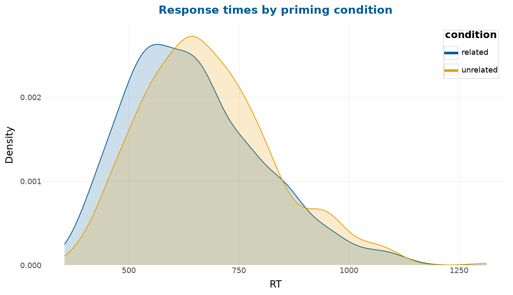
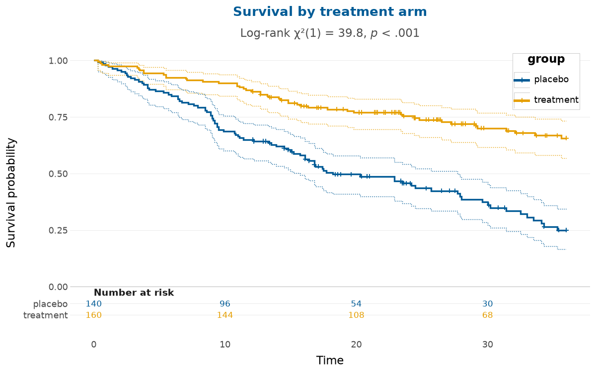

# depictr (Python)

<!-- badges: start -->
[](https://github.com/pablobernabeu/depictr-py/actions/workflows/ci.yml)
[](https://pablobernabeu.github.io/depictr-py/)
[](https://pypi.org/project/depictr/)
[](https://pypi.org/project/depictr/)
[](https://opensource.org/license/MIT)
[](https://doi.org/10.5281/zenodo.21266311)
<!-- badges: end -->

Documentation and example gallery:
<https://pablobernabeu.github.io/depictr-py/>

A unified, colourblind-safe toolkit for publication-ready statistical
visualisation, built on [plotnine](https://plotnine.org).

This is the Python sibling of [the R
package](https://pablobernabeu.github.io/depictr/) of the same name, which
covers the same workflow and is built on [ggplot2](https://ggplot2.tidyverse.org).
The two share a design and most of their functions. Many of the R functions'
arguments have yet to be ported, and the Status section below lists where the
two differ.

## Gallery

The figures below, each from a single function call, show a grouped density in
the default palette and Kaplan-Meier survival curves with a log-rank test and a
number-at-risk table.





The calls that produce the two figures set a title and use `legend_inside`,
options that the
[Get started](https://pablobernabeu.github.io/depictr-py/getting-started/)
guide shows and the short tour below leaves out. The
[example gallery](https://pablobernabeu.github.io/depictr-py/gallery/exploring-data/)
has more figures.

## What it is for

Python already has a good plot for almost any statistical task, but those plots
come from different packages with different defaults. A single figure set for a
paper might draw on seaborn, scikit-learn, statsmodels, lifelines and ArviZ,
each with its own appearance, API and colour scheme. Only one of them uses
colourblind-safe colours by default. Making the set consistent and accessible
then means repeating the same theming by hand on every plot.

depictr does that work once. It gives the whole workflow one theme, one
colourblind-safe palette and one calling convention, and returns plotnine
objects that can be refined further with the usual `+` syntax. Where a
specialist package already computes a quantity well, depictr delegates the
computation to it and redraws the result under the shared theme.

## Accessibility by default

The default palette is based on the Okabe-Ito set. To test that choice, the
package provides a simulator of colour-vision deficiency based on the model of
Machado, Oliveira and Fernandes (2009), and a CIEDE2000 colour-difference test
that measures how far apart the palette's colours stay under each deficiency:

```python
import depictr as dp

dp.palette_safety()
# {'min_delta_e': ..., 'by_condition': {'normal': ..., 'protan': ...,
#  'deutan': ..., 'tritan': ...}, 'worst_condition': ..., 'worst_pair': ...,
#  'safe': True, 'threshold': 5.0}
```

The colourblind-safety guarantee covers the eight built-in colours. A plot with
more than eight groups has to interpolate between them, and the interpolated
colours no longer clear the distance threshold, so `depictr_palette` warns when
asked for a ninth. When a figure needs more groups, facet them or map them to
the sequential ramp.

Once a plot has been extended with your own scale, shrunk to fit a journal
column or drawn so that colour alone distinguishes its groups, the palette's
guarantee no longer describes what a reader will see. `check_figure` audits the
plot you are about to submit and reports each measured value next to its
threshold:

```python
p = dp.explore_distribution(dp.lexical_decision(), "RT", group="condition")
dp.check_figure(p, width_cm=8.9)
```

The audit measures the separability of the encoding colours under each
dichromacy and in greyscale, the smallest text size at the printed width, the
WCAG contrast of text and geometry against their backgrounds, and whether any
distinction rests on colour alone. The size check covers the text drawn inside
the panel and around it, and the contrast check covers only the text around it.
For a figure saved at its final width, give that width as both `width_cm` and
`render_width_cm`, leave both at their defaults or let `save_plot(check=True)`
audit the figure at the width it saves. For a journal that caps text size, as
Nature does at 7 pt, pass the cap as `max_text_pt`.

The audit does not check continuous colour scales, and the colour rows of a
heatmap state this. For continuous scales, prefer a perceptually ordered map
such as viridis or the package's sequential and diverging ramps.

The colourblind-safety guarantee also covers only hue confusion. In greyscale,
the palette's orange and sky blue differ by only 0.79 in CIE lightness, so they
print as the same grey. A figure that may be printed in black and white should
use fewer groups, a sequential palette, or a redundant shape or line type.

The palette also falls short on contrast. Four of the eight colours fall below
the 3:1 contrast against white that WCAG asks of a graphical object. The orange
is one of them. As the second colour, it appears in every default figure that
colours two or more groups. The example above therefore fails
`geometry_contrast`, as well as `redundant_encoding` and, at 8.9 cm,
`text_size`. With opaque marks, the vermillion `#d55e00` in the orange's place
and a redundant shape or line type, the figure passes `geometry_contrast` and
`redundant_encoding`. Adding `dp.scale_colour_depictr(order="contrast")` to a
plot makes that substitution.

## Installation

depictr is on [PyPI](https://pypi.org/project/depictr/). The first command
below installs the core (plotnine, pandas, numpy, matplotlib and scipy), and the
second adds the optional computation back-ends. The double quotes keep zsh, the
default shell on macOS, from reading the brackets as a filename pattern.

```bash
pip install depictr
pip install "depictr[all]"
```

The classification and survival plots delegate to scikit-learn and lifelines.
Each is an optional dependency, installed with the `depictr[classification]` or
`depictr[survival]` extra when your plots need it. The gains, lift and
calibration curves are computed by depictr itself and need neither. The PCA,
scree, cluster and silhouette plots also need scikit-learn, from the same
`depictr[classification]` extra, and the dendrogram needs only scipy, a core
dependency. The model and time-series plots delegate to statsmodels, which
plotnine requires, so the core install includes it. The `depictr[models]` extra
is kept to set the tested minimum version of statsmodels.

The development version can be installed from GitHub:

```bash
pip install git+https://github.com/pablobernabeu/depictr-py
```

## A short tour

```python
import depictr as dp

# Exploratory analysis
ld = dp.lexical_decision()
dp.explore_distribution(ld, "RT", group="condition", kind="both")

wb = dp.wellbeing_survey()
dp.correlation_heatmap(wb)
dp.missingness_map(wb)

# Model estimates: a fitted model OR a tidy data frame
import statsmodels.formula.api as smf
# Q() quotes "yield" because it is a Python keyword.
fit = smf.ols('Q("yield") ~ fertiliser + rainfall + soil_ph + treatment',
              dp.crop_yield()).fit()
dp.coefficient_plot(fit)

# Classification: computed by scikit-learn, themed by depictr
ct = dp.clinical_trial()
dp.roc_curve_plot(ct["adverse_event"], ct["biomarker"])

# Survival: Kaplan-Meier with confidence limits and a log-rank test, in one call
dp.survival_plot(ct["time"], ct["event"], group=ct["arm"], logrank=True)
```

Every plotting function returns a plotnine object, to which the usual
grammar-of-graphics extensions apply:

```python
from plotnine import labs

dp.roc_curve_plot(ct["adverse_event"], ct["biomarker"]) + labs(title="Adverse event")
```

## The web app

A Streamlit app provides a gallery and a quick way to try the package. It loads
one of the bundled datasets or a CSV you upload, draws the chosen plot, shows
the exact Python call that produced it, and offers a colourblind-vision toggle
that re-renders the figure as each deficiency would be seen. The app is not
included in the wheel, so run it from a clone of the repository:

```bash
git clone https://github.com/pablobernabeu/depictr-py
cd depictr-py
pip install -e ".[all]"
streamlit run app/streamlit_app.py
```

The `all` extra installs Streamlit with scikit-learn and lifelines, which most
of the classification and multivariate panes and the Kaplan-Meier pane need.
`pip install -e ".[app]"` installs Streamlit alone, and those panes then report
which package is missing.

## Function families

The exported functions fall into families that follow the analysis workflow.

| Family | Functions |
| --- | --- |
| Theme and palette | `theme_depictr`, `scale_colour_depictr` (also spelt `scale_color_depictr`), `scale_fill_depictr`, `depictr_palette`, `depictr_brand`, `depictr_accent`, `legend_inside` |
| Accessibility | `check_figure`, `palette_safety`, `simulate_cvd`, `simulate_figure` |
| Exploratory analysis | `explore_distribution`, `explore_categorical`, `explore_bivariate`, `scatter_trend`, `correlation_heatmap`, `missingness_map`, `ecdf_plot`, `ridgeline_plot`, `dumbbell_plot`, `outlier_plot`, `group_comparison_plot`, `raincloud_plot`, `explore_pairs` |
| Estimation and tables | `estimation_plot` (single- or two-panel Cumming), `summary_table` |
| Model estimates | `coefficient_plot`, `tidy_estimates`, `effects_plot`, `interaction_plot`, `compare_models`, `random_effects_plot`, `posterior_plot`, `frequentist_bayesian_plot`, `power_curve_plot`, `format_terms` |
| Diagnostics | `qq_plot`, `influence_plot`, `vif_plot`, `binned_residual_plot`, `residual_diagnostics_plot`, `model_report` |
| Classification | `roc_curve_plot`, `pr_curve_plot`, `confusion_matrix_plot`, `calibration_plot`, `gain_plot`, `lift_plot`, `threshold_plot` |
| Multivariate | `pca_plot`, `scree_plot`, `cluster_plot`, `dendrogram_plot`, `silhouette_plot` |
| Survival | `survival_plot` (with an optional number-at-risk table) |
| Time series | `acf_plot`, `decompose_plot`, `seasonal_plot`, `timeseries_plot` |
| Composition | `arrange_plots`, `save_plot` |
| Data | `crop_yield`, `wellbeing_survey`, `lexical_decision`, `clinical_trial`, `monthly_sales`, and `DATASETS`, the four cross-sectional loaders by name |

## Status

This is an early release. The colourblind-safe theme, the accessibility check
and most of the R package's plotting functions across every family (EDA,
estimation, model estimates, diagnostics, classification, multivariate,
survival and time series) are in place and tested. The multi-panel composites
are the four-panel `residual_diagnostics_plot`, the `model_report` dashboard,
the two-panel Cumming `estimation_plot` and the `explore_pairs` matrix. All
four are built on `arrange_plots`, which uses plotnine's native plot
composition.

Six functions from the R package have yet to be ported: `optimizer_fixef_plot`,
`k_diagnostic`, `palette_preview`, `model_fit_table`, `ts_forecast` and the
session-wide settings of `depictr_options`. `optimizer_fixef_plot` plots the
output of `lme4::allFit`, which has no direct statsmodels equivalent. Of the
`depictr_options` settings, the font has an equivalent in plotnine's own
option, which every depictr theme reads. `plotnine.options.base_family = "Arial"`
sets the font of every plot made afterwards, and a plot made before the option
is set keeps its font. `theme_depictr(base_family="Arial")` sets it for one
plot.

The functions the two packages share take many of the same arguments, though
far from all. The
[parity manifest](https://github.com/pablobernabeu/depictr-py/blob/main/tests/test_parity_manifest.py)
accounts for every argument of the R functions. It names the arguments this
package calls something else, such as `kind` for R's `type` and `event` for its
`status`, the ones it has yet to take and the few that only it takes. Its tests
fail when either package changes a signature the manifest does not record.
Most of the missing arguments are cosmetic, such as a colour, a palette or an
axis title, which can be added to a plotnine object with `+`. The differences
below change what a figure shows or how it is computed.

Among the exploratory plots, `explore_pairs` draws a scatter plot in both
triangles of its matrix, where the R function prints the correlations above the
diagonal. It also keeps the first five columns without a warning, where the R
function stops with an error when given more than `max_cols` columns, eight by
default.

Among the model-estimate plots, `posterior_plot` draws each posterior as its
median with 66% and 95% intervals, the R function's default widths. It draws no
half-eye density, which R draws by default when ggdist is installed, and it has
none of R's `style`, `widths`, `rope` or `pd`. `frequentist_bayesian_plot`
draws every term on one shared axis, where the R function gives each term a
panel and an x-axis of its own by default. `effects_plot` draws no rug of the
observed values, which the R function adds by default. `power_curve_plot` reads
the same tables as the R function, pilotr's included, but it has no `x_lab`,
`x_breaks` or `x_expand`, and there is no simr object to read.

Among the diagnostic plots, `model_report` draws the coefficients on their own
scale beside a residual panel and a Q-Q plot, where the R function standardises
the continuous predictors by default and adds an effects panel and a subtitle
of fit statistics. `influence_plot` labels no point and draws only the line at
zero. The R function labels the three points with the largest Cook's distance
and adds reference lines at studentised residuals of -2 and 2 and at twice the
mean leverage. `qq_plot` draws no confidence band, where the R function draws a
pointwise 95% band by default.

Among the classification plots, each curve shows a single model. The R
package's ROC, precision-recall, calibration, gains and lift functions also
overlay several models given as a named list, and its gains chart adds a
perfect-model line. `roc_curve_plot` has neither the confidence band nor the
Youden point that R's `ci` and `youden` add. `threshold_plot` marks no
threshold, where the R function marks the Youden and maximum-F1 thresholds by
default.

Among the multivariate plots, `cluster_plot` draws neither the convex hulls nor
the centroid labels that the R function adds by default. `dendrogram_plot`
merges clusters by Ward's method by default and labels no leaves, where the R
function uses complete linkage and labels the leaves of any tree with 40 or fewer.
`silhouette_plot` runs k-means for `k` clusters itself, where the R function
draws the silhouettes of a clustering computed elsewhere, whose assignments it
takes in `clusters`.

In the time-series family, `decompose_plot` performs a classical decomposition,
where the R function uses STL by default. `timeseries_plot` draws no forecast,
which the R function adds with `forecast`. It draws a single series, where the R
function also draws one line per column of a multivariate `ts`, or one per group
of a long table given through `time`, `value` and `group`. `seasonal_plot`
draws one line per cycle, the layout of R's `style = "season"`, where the R
function defaults to the faceted subseries plot with each season's mean.
`acf_plot` raises an error for a series with a missing value inside it, where
the R function computes the correlations across the gap from the pairs of
observations present, with a warning.

Some defaults also differ. `dumbbell_plot` orders the categories by the value
of the group's first level, where the R function orders them by the gap between
the two groups. `explore_categorical` keeps the order of the levels and, with a
group, shows proportions within each group, where the R function sorts the bars
from most to least frequent and shows counts. `explore_distribution` draws a
density by default, where the R function draws a histogram. It fills a grouped
density at an alpha of 0.2, where the R function uses its default of 0.6, so
pass `alpha` for the same fill in both. It also overlays grouped histogram
bars, where the R function dodges them. `estimation_plot` draws only the
differences unless `two_panel=True`, where the R function always draws the
two-panel Cumming plot. `survival_plot` prints the log-rank test by default,
where the R package leaves it out, and warns that its default will change to
match.

Compositions in plotnine have no figure-level title, subtitle or collected
legend, so any title in a grid is drawn on one of its panels. The two-panel
`estimation_plot` puts the title on its top panel. `arrange_plots` tags the
panels A, B, C and so on, as the R function does. Among the package's own
composites, only `model_report` is tagged, as in R. In this package, each tag is
part of its panel's plot, so `check_figure` measures it with the rest of the
panel's text. The R function draws its tags around the panels, where they are
not measured.

## Relationship to the R package

The two packages share no code. Each gives the whole workflow one accessible
theme, takes its input either as a fitted model or as a data frame, and returns
plot objects that can be refined further with `+`.

## Citation

The [About page](https://pablobernabeu.github.io/depictr-py/about/) shows the
preferred citation with a BibTeX entry and a short note on the developer, and
the repository includes
[`CITATION.cff`](https://github.com/pablobernabeu/depictr-py/blob/main/CITATION.cff)
for the *Cite this repository* button on GitHub. The citation uses the concept
DOI of the Zenodo archive, <https://doi.org/10.5281/zenodo.21266311>, because
PyPI assigns no DOI.

## Licence

MIT. See [LICENSE](https://github.com/pablobernabeu/depictr-py/blob/main/LICENSE).

## Contributing

Issues and pull requests are welcome. The [contributing
guide](https://github.com/pablobernabeu/depictr-py/blob/main/.github/CONTRIBUTING.md)
describes the development setup and the conventions the package follows.
Everyone taking part is asked to honour the [Code of
Conduct](https://github.com/pablobernabeu/depictr-py/blob/main/.github/CODE_OF_CONDUCT.md).
